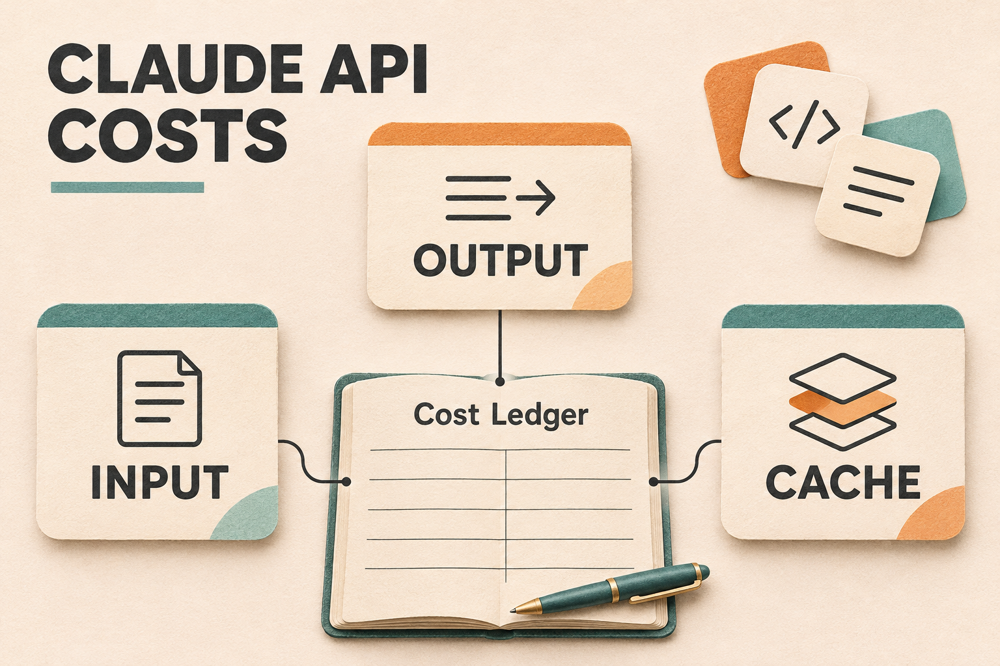

# Cheap Claude API: Compare Providers and Estimate Your Costs

You can find several cheap Claude API offers and still have no clear monthly budget. One page leads with a low input rate, another with a cached rate, and another with a discount for work that can wait.

Tokens are pieces of text the model processes. You pay separately for what you send and what Claude generates; repeated material can sometimes be reused at a different rate. A low rate helps only when it applies to the tokens your application actually sends or generates.

Start by comparing one model version across providers, then calculate the cost of your input, output and repeated context. The prices and worked examples below show how to do that, including when staying with Anthropic and changing the processing mode can make sense.



*Conceptual illustration: a workload estimate combines several billing categories.*

In this guide: [Start with a model-specific price](#start-with-a-model-specific-price) · [Repeated context changes the comparison](#repeated-context-changes-the-comparison) · [Use Batch when the work can wait](#use-batch-when-the-work-can-wait) · [Put the same workload through the rates](#put-the-same-workload-through-the-rates) · [Choose the route you can actually use](#choose-the-route-you-can-actually-use)

## Start with a model-specific price

Choosing a smaller model and buying the same model from a different seller are separate decisions. A classification feature may be a candidate for Haiku; a harder reasoning task may need Sonnet or Opus. Decide what quality the task requires before treating their prices as interchangeable.

For orientation, Anthropic publishes these standard API rates in USD per million tokens, checked November 6, 2026:

| Model and prompt condition | Input | Output |
|---|---:|---:|
| Claude Haiku 5.5, prompt up to 100,000 tokens | $0.10 | $0.50 |
| Claude Haiku 5.5, prompt over 100,000 tokens | $0.50 | $2.50 |
| Claude Sonnet 5.5 | $2.00 | $10.00 |
| Claude Opus 5.5 | $4.00 | $20.00 |

The source is [Anthropic](https://platform.claude.com/docs/en/about-claude/pricing). Haiku's threshold applies to the whole request, including cached input; it is not just a surcharge on the tokens above the threshold. Moduck's [Haiku 5.5 pricing](https://moduck.ai/models/c/anthropic/claude-haiku-5-5) lists $0.08 input and $0.40 output, but its visible panel does not specify that long-prompt boundary. Confirm the applicable tier before pricing a large Haiku request.

To compare sellers, hold the model at **Claude Sonnet 5.5**. These are public quotes checked November 6, 2026, in USD per million tokens. They are a price snapshot, not an equivalent-service ranking or measured bills.

| Provider or quoted route | Input | Output | Condition to keep with the quote |
|---|---:|---:|---|
| [Anthropic](https://platform.claude.com/docs/en/about-claude/pricing), standard | $2.00 | $10.00 | Global standard pricing; cache and other modes billed separately |
| [Anthropic](https://platform.claude.com/docs/en/about-claude/pricing), Batch | $1.00 | $5.00 | Asynchronous processing, with a 24-hour processing window |
| [Bourse](https://bourse.run/pricing/claude-api) | $1.00 | $5.00 | Seller's Sonnet 5.5 listing; cache terms absent from the visible matrix |
| [CheapAI](https://cheapai.io/en/models/claude-sonnet-5-5) | $0.26 | $1.33 | Model-specific listing; cache read/write quoted separately |
| [aicodewith](https://aicodewith.ai/en/cheap-claude-api), Economy | from $0.38 | from $1.90 | Economy channel; other channels cost more and can differ in availability and speed |
| [Moduck](https://moduck.ai/models/c/anthropic/claude-sonnet-5-5) | $1.60 | $8.00 | Model-detail quote; cache rates separate, serving upstream not identified in the public price panel |
| [UberLLM](https://uberllm.dev/guides/cheapest-claude-api), live seller quote | $0.0619 | $0.3094 | Variable live rate; card top-ups add 5.5% + $0.50 |

For a feature that generates long answers, compare output rates as carefully as input rates. The lowest displayed input rate is only one component. UberLLM's card fee, for example, makes adding $10 of credit a $11.05 cash outlay. That is a funding cost, separate from the per-token balance charge. A channel's “from” rate also does not describe every route it offers.

These quotes establish what each seller publicly offers. They do not establish equal model delivery, features, latency, data handling or support. A model name in a response is useful diagnostic information, but it cannot independently establish who served the request or its quality.

Temporary API testing credits and subscription-linked API allowances are another budget category. They can reduce an eligible account's initial cash spend, but they should be evaluated separately from an ongoing per-token price.

## Repeated context changes the comparison

A support assistant may send the same policy document with each question. Sending that document at the normal input rate each time can be expensive. Prompt caching lets a later request reuse a saved beginning of the prompt, called a prefix.

The first qualifying request creates a **cache write**. Later matching requests create **cache reads**, also called hits. A write may cost more than ordinary input, while a read costs less. New questions and other uncached material still incur ordinary input charges, and generated answers still incur output charges.

For Sonnet 5.5, Anthropic publishes $2.50 per million tokens for a five-minute write, $4.00 for a one-hour write, and $0.10 for a read. Its [prompt caching documentation](https://platform.claude.com/docs/en/build-with-claude/prompt-caching) explains how to opt in, the 512-token minimum for Sonnet 5.5, and cache invalidation. A five-minute cache needs matching reuse before expiry; a saved prefix is not a permanent discount.

Compare those categories separately. Moduck's Sonnet 5.5 page lists a $0.16 cached-input rate and a $2.00 cache-write rate, without identifying the write duration in the visible pricing panel. CheapAI lists $0.03 for reads and $0.33 for writes, also without a duration in its visible panel. Do not silently label either write as Anthropic's five-minute configuration.

This is why a provider with cheaper ordinary input can still cost more on a workload dominated by cache reads. Whether that happens depends on the actual token mix and on whether the service can deliver the required cache behavior. Missing cache terms need confirmation before a budget assumes a high hit rate.

## Use Batch when the work can wait

An overnight document backfill has a different deadline from a customer waiting for an answer. Anthropic's Batch API processes requests asynchronously at half the standard input and output rates. Sonnet 5.5 becomes $1.00 input and $5.00 output per million tokens without changing the model.

The [Batch documentation](https://platform.claude.com/docs/en/build-with-claude/batch-processing) gives a processing window of up to 24 hours; requests that do not finish can expire. Results arrive as batch results rather than an interactive stream. That can suit evaluations, reports and backfills, but not a live chat turn with a short response deadline.

Batch and prompt caching can be combined, though cache hits within a batch are best effort. Do not assume a sequential chat's reuse pattern will occur inside a batch. Fast mode is unavailable with Batch and has separate premium prices. Anthropic also charges more for US-only inference on supported models; partner-operated cloud platforms have their own prices. Paid server tools can add charges beyond model tokens.

If your reports can wait, put the direct Batch rate beside the gateway quote before deciding to move traffic. An ordinary synchronous request and a delayed batch request solve different timing requirements even when their model name matches.

## Put the same workload through the rates

Consider a hypothetical support-drafting feature on Sonnet 5.5. It makes **20,000 requests per month**, each with **6,000 input tokens** and **400 output tokens**. Of the input, 5,000 tokens are a shared policy prefix and 1,000 are new material.

For the cached version, assume 1,000 groups of 20 requests. Each group starts with a cold or changed 5,000-token prefix, writes it once, then reuses it 19 times before the cache expires, with no invalidation. The prefix qualifies for caching. This is an assumed usage pattern, not a measured hit rate or a customer bill.

Without caching, the workload uses 120 million input tokens and 8 million output tokens. With the stated reuse, those same 120 million input tokens divide into:

- Ordinary input: 20,000 × 1,000 = **20 million tokens**.
- Cache writes: 1,000 × 5,000 = **5 million tokens**.
- Cache reads: 1,000 × 19 × 5,000 = **95 million tokens**.

Count each input token in exactly one category. With token quantities expressed in millions, the calculation is:

```text
Token cost = ordinary input × input rate
           + cache writes × write rate
           + cache reads × read rate
           + output × output rate
```

For Anthropic's five-minute cache, that is:

```text
(20 × $2.00) + (5 × $2.50) + (95 × $0.10) + (8 × $10.00)
= $40.00 + $12.50 + $9.50 + $80.00
= $142.00
```

| Arrangement | Arithmetic at the quoted rates | Token-cost estimate |
|---|---|---:|
| Anthropic standard, no cache | 120 × $2 + 8 × $10 | $320.00 |
| Moduck, no cache | 120 × $1.60 + 8 × $8 | $256.00 |
| CheapAI, no cache | 120 × $0.26 + 8 × $1.33 | $41.84 |
| Anthropic Batch, no cache | 120 × $1 + 8 × $5 | $160.00 |
| Anthropic standard, stated five-minute reuse | 20 × $2 + 5 × $2.50 + 95 × $0.10 + 8 × $10 | $142.00 |

Sources are the seller links above and Anthropic's pricing/Batch documentation. These calculations exclude taxes, paid tools, retries, funding fees, promotional credit, and output beyond the stated allowance, including any additional billed thinking tokens. They hold token counts constant and do not establish equal quality or service. A model change can also change tokenization, so reuse your measured counts for the exact model rather than assuming identical text always produces identical usage.

The small differences between rate categories can matter on a more repetitive workload. As a separate sensitivity example, take 1 million ordinary-input tokens, 1 million cache-write tokens, 100 million cache-read tokens and 1 million output tokens. Anthropic's listed five-minute categories give **$24.50**: $2 + $2.50 + $10 + $10. Applying Moduck's listed categories gives **$27.60**: $1.60 + $2 + $16 + $8.

That second result is conditional arithmetic. It becomes a usable cross-service estimate only after confirming Moduck's write duration and that both services can achieve those same billed categories. It shows how a higher cache-read rate can outweigh lower input and output rates; it does not establish that Anthropic is cheaper for every cached workload.

For your budget, record ordinary input, cache writes, cache reads and output from a representative sample of your traffic. Include cold starts and rewrites. Then multiply each total by the applicable rate and add funding or tool charges separately.

## Choose the route you can actually use

For short, independent tasks, first check whether a smaller Claude model meets your quality requirements. For repeated long context, compare the achieved cache-read/write mix. For work that can wait, price Batch before changing your provider. These are different ways to reduce spend, and the useful one depends on the application.

A discounted gateway is worth shortlisting when its model, interface, rate limits and commercial terms fit your application. Before committing traffic, confirm the serving route or channel, model version, cache behavior, billing units, funding/refund terms and data requirements. A low public quote is a reason to investigate, not proof of equivalent service.

Moduck is one such option for teams evaluating a unified model API. Its [pricing page](https://moduck.ai/pilot/pricing) publishes a $10 minimum top-up and no fixed monthly fee. The rate table above gives its Sonnet quote alongside other sellers; it is not the lowest quoted ordinary rate in that sample. Check the model's current price and [documentation](https://docs.moduck.ai/) against your required interface and cache behavior before treating the estimate as a spending plan.

If Moduck fits your model, interface and billing requirements, continue with the key setup. [Get API Key](https://moduck.ai/dashboard/api-keys). Sign-in required. The public entry opens the sign-in page. Confirm account access to the intended model and the applicable billing terms before funding or sending traffic.
